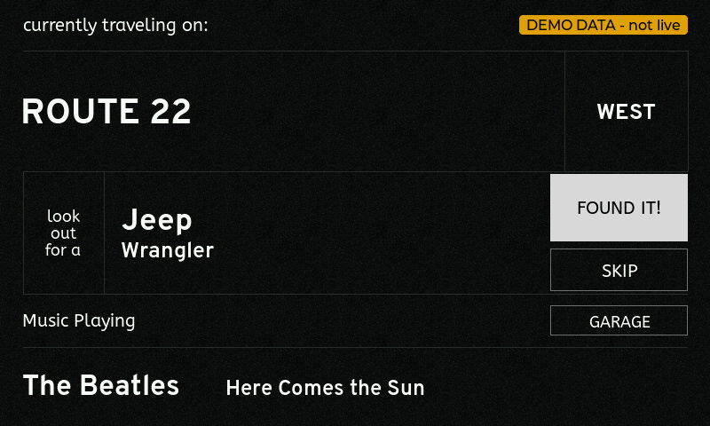
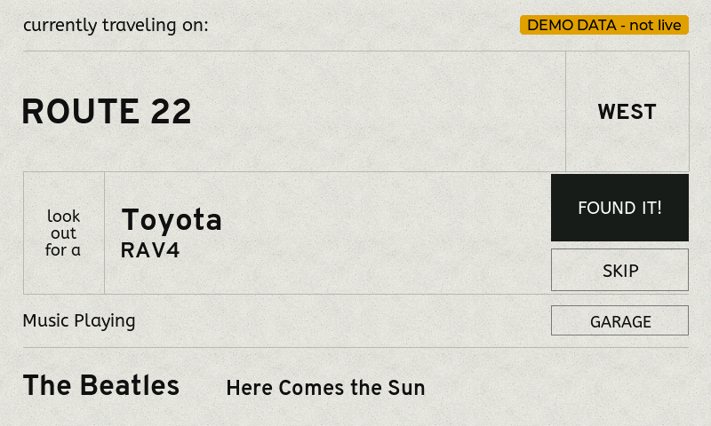
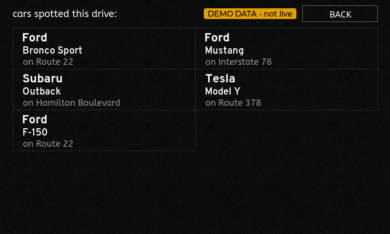

# Backseat Driver

A quiet headrest display for a five-year-old. It answers the three questions every backseat passenger asks:
**what road are we on, what car should I look for, and what song is this?**

| Night | Day | Garage |
|---|---|---|
|  |  |  |

- **Road:** the road you're on, with its signed direction ("Route 22 West") or a compass heading when there isn't one.
- **Car spotting:** one car to look for, by make and model (no photos, so it's a real spotting game). Tap **FOUND IT!** or **SKIP**.
- **Garage:** every car found this drive, newest first, with the road where it was spotted.
- **Music:** the song and artist playing on Spotify.
- **Day and night:** a dark asphalt look at night and a light concrete look by day, switched by the sun's position.

It's calm on purpose: no animation beyond a soft text fade, no sounds, and nothing to scroll on the main screen.

## How it works

```
iPhone app (SwiftUI)                         Headrest display (ESP32-S3, 800×480 touch)
  GPS + map matching  ─┐                       ┌─ bsd_feed  (what the display knows)
  Spotify Web API     ─┼── Bluetooth LE ──────►├─ bsd_ui    (main + garage screens, LVGL)
  sunrise/sunset      ─┘                       └─ bsd_cars  (catalog + this drive's garage)
```

The phone does all the thinking (location, road names, Spotify, day/night) and sends small text messages over BLE.
The display only draws. The same UI code runs in a desktop simulator and on the board.

## Hardware

- [Waveshare ESP32-S3-Touch-LCD-4.3](https://www.waveshare.com/esp32-s3-touch-lcd-4.3.htm) (800×480 RGB panel, GT911 touch, 16 MB flash, 8 MB PSRAM)
- USB-C power from the car
- An iPhone running the companion app

## Repository layout

```
app/        Shared C code, compiled by both the simulator and the firmware
  bsd_feed    What the display knows (road, song, link, data source). Sources write, the UI reads.
  bsd_link    BLE message parser (the phone's message format)
  bsd_cars    Car catalog, rarity-weighted picker, This Drive garage
  bsd_demo    Scripted indoor replay, always labeled as demo data
  bsd_ui      Main screen and garage screen
  fonts/      LVGL bitmap fonts (Overpass and ABeeZee, both OFL)
sim/        SDL desktop simulator with screenshot and layout tests
firmware/   ESP-IDF project for the board (BLE, display, touch)
phone/      iPhone companion app (SwiftUI, XcodeGen)
docs/       Integration notes, enclosure notes, rendered screenshots
```

## Quick start: the simulator (macOS)

Needs Homebrew `cmake`, `pkg-config` and `sdl2`.

```bash
brew install cmake pkg-config sdl2
sim/run.sh
```

This opens an 800×480 window where the mouse stands in for touch. A demo replay starts automatically and is
labeled **DEMO DATA - not live**.

```bash
sim/run.sh --shots
```

Renders every display state, in both themes, to `docs/screens/*.png`. It also runs stress cases (very wide letters,
very long road and song names, every catalog car), checks that no text spills out of its box, and runs touch tests
on the real buttons. It exits non-zero on any failure.

Simulator keys: `n` next demo step, `p` pause, `d` phone link on/off, `r` drop location, `m` drop song,
`f`/`s` Found/Skip, `g` print the garage, `x` new drive, `o` demo on/off, `t` day/night, `a` text animation on/off.

## Firmware

Uses ESP-IDF **v5.5.x** and LVGL **9.5.0**. See [firmware/README.md](firmware/README.md) for board notes and the
bring-up checklist.

```bash
firmware/build.sh          # build
firmware/build.sh flash    # build and flash
firmware/build.sh monitor  # serial log
```

Back up your board's factory flash before the first flash (instructions in
[firmware/factory-backup/README.md](firmware/factory-backup/README.md)).

## Phone app

See [phone/README.md](phone/README.md). Before building you'll need to:

1. Set your own Apple team ID (`DEVELOPMENT_TEAM` in `phone/project.yml`, or in Xcode's Signing settings).
2. Create a Spotify developer app and put its Client ID in `phone/BackseatDriver/Spotify.swift`.

## Open questions

- How a drive starts and ends. For now a drive starts at boot, and `bsd_drive_start()` resets it.
- Keeping the garage across power loss (NVS or SD card). Today it lives in RAM for the current drive.
- Button size for small fingers. FOUND IT! is 155×76 px (about 18×8.5 mm) and SKIP 155×48 px. `docs/enclosure.md` has a fallback.

## Credits

Built with [LVGL](https://lvgl.io), [ESP-IDF](https://github.com/espressif/esp-idf), and the
[Overpass](https://github.com/RedHatOfficial/Overpass) and [ABeeZee](https://fonts.google.com/specimen/ABeeZee) typefaces
(SIL Open Font License). Developed with [Claude Code](https://claude.com/claude-code).
